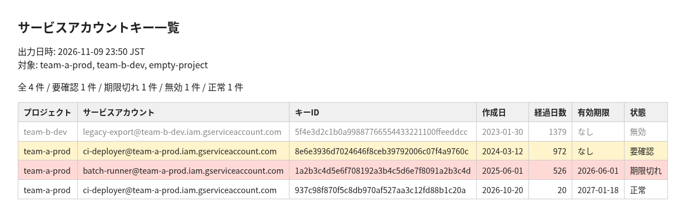

= GoogleCloudでサービスアカウントキーの一覧をHTMLレポートにする

サービスアカウントキーは長期間有効な認証情報なので、定期的に棚卸ししたい。 +
コンソールではサービスアカウントごとに確認が必要で手間がかかるため、複数プロジェクトのキーを1枚のHTMLにまとめるスクリプトを作成。

サンプルデータで出力したレポートは次のとおり。

== 方法

gcloudの出力形式にHTMLはないため、JSONで取得してjqでHTMLに変換する。

=== 準備

* gcloud CLIとjqをインストール
* *gcloud auth login* でログイン
* 対象プロジェクトで View Service Accounts(roles/iam.serviceAccountViewer)ロールを付与

=== スクリプト

.sa-keys-report.sh
[source,bash]
----
include::sa-keys-report.sh[]
----

=== 実行

.プロジェクトを指定して実行
[source,bash]
----
bash sa-keys-report.sh my-project-a my-project-b > report.html
----

要確認にする日数は環境変数 *WARN_DAYS* で変更できる。既定は90日。

.30日以上経過したキーを要確認にする
[source,bash]
----
WARN_DAYS=30 bash sa-keys-report.sh my-project-a > report.html
----

.アクセスできる全プロジェクトを対象にする
[source,bash]
----
bash sa-keys-report.sh $(gcloud projects list --format='value(projectId)') > report.html
----

権限がないプロジェクトなどでgcloudが失敗すると、そこでエラー終了する。一覧の取りこぼしに気付けるよう、エラーは無視していない。

=== 結果

作成日が古い順に出力される。状態は上から順に判定する。

|===
|状態 |条件

|無効
|キーが無効化されている

|期限切れ
|有効期限を過ぎている

|要確認
|作成から *WARN_DAYS* 日以上経過している

|正常
|上記以外
|===

== 補足

* *--managed-by user* でユーザー管理のキーのみを対象にしている。システム管理のキーはGoogleが管理・ローテーションするため対象外。
* 有効期限のないキーは *validBeforeTime* が *9999-12-31T23:59:59Z* になるので、有効期限を「なし」と表示している。
* 取得するのはキーのメタデータのみで、秘密鍵は含まれない。ただしプロジェクトIDやサービスアカウント名が載るので、レポートの取り扱いには注意する。
* キーごとの最終認証日時は *gcloud policy-intelligence query-activity* で確認できるので、未使用のキーを洗い出す場合に使える。

.キーの最終認証日時を確認する
[source,bash]
----
gcloud policy-intelligence query-activity \
  --activity-type=serviceAccountKeyLastAuthentication \
  --project=my-project-a
----

== 参考

* https://cloud.google.com/sdk/gcloud/reference/iam/service-accounts/keys/list[gcloud iam service-accounts keys list]
* https://cloud.google.com/iam/docs/keys-list-get[List and get service account keys]
* https://cloud.google.com/iam/docs/reference/rest/v1/projects.serviceAccounts.keys[REST Resource: projects.serviceAccounts.keys]
* https://cloud.google.com/iam/docs/best-practices-for-managing-service-account-keys[Best practices for managing service account keys]
* https://cloud.google.com/sdk/gcloud/reference/policy-intelligence/query-activity[gcloud policy-intelligence query-activity]
